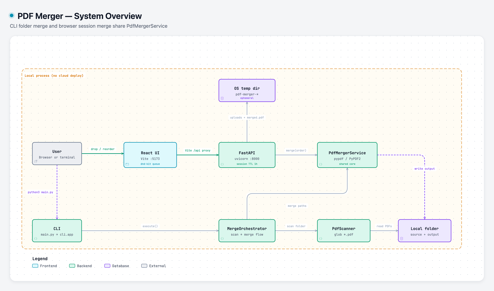

<div align="center">
  <h1>PDF Merger</h1>
  <p><strong>Merge PDFs from a folder via CLI, or reorder uploads in a local browser UI backed by FastAPI.</strong></p>
</div>


## Overview

**What it does** — Discovers and merges PDF files into one document. Two entry points share the same merge core:

1. **CLI** — scan a folder (optional recursive), sort alphabetically, write a single PDF.
2. **Local web UI** — drag-and-drop uploads, reorder with dnd-kit, merge through a session API.

**Why it exists** — Combine course packs, scans, or export dumps without manual Acrobat shuffling.

**Status** — Production-ready for **local** use. In-memory sessions and OS temp storage; not a multi-tenant cloud service.

## Tech Stack

| Layer      | Technology                             |
| ---------- | -------------------------------------- |
| Language   | Python 3.8+                            |
| PDF engine | pypdf ≥ 4.0 (PyPDF2 fallback)          |
| CLI        | argparse, tqdm                         |
| HTTP API   | FastAPI, uvicorn, python-multipart     |
| Web UI     | React 18, Vite 6, TypeScript, Tailwind |
| UI libs    | @dnd-kit, framer-motion                |
| Tests      | pytest, httpx, Vitest, Testing Library |
| Formatting | black, isort                           |

## Architecture

CLI and browser paths both call `PdfMergerService`. The API keeps per-session files under the OS temp directory with a 1-hour TTL. The Vite dev server proxies `/api` to uvicorn on port 8000.

Interactive diagram (open in a browser):

**[docs/diagrams/architecture.html](docs/diagrams/architecture.html)**

> Drop updated diagram HTML at that path to keep the README link working.

### System overview



## Project Structure

```
pdf-merger/
├── main.py                 # CLI entry → cli.app.main()
├── api/
│   ├── main.py             # FastAPI app + CORS wiring
│   ├── routes.py           # session / upload / merge / download
│   ├── store.py            # in-memory sessions + TTL cleanup
│   ├── models.py           # session dataclasses + MergeRequest
│   ├── uploads.py          # chunked copy + PDF validation
│   └── constants.py        # limits + CORS origins
├── web/                    # Vite + React local UI
│   └── src/
│       ├── api/            # fetch client (/api)
│       ├── components/     # Dropzone, queue, merge bar
│       ├── hooks/          # usePdfSession
│       └── ...
├── cli/
│   ├── app.py              # PdfMergerApp wiring + exit codes
│   └── parser.py           # argparse
├── core/
│   ├── orchestrator.py     # folder validate → scan → merge
│   ├── scanner.py          # PDF discovery
│   └── merger.py           # PdfMergerService + MergeOutcome
├── config/                 # MergeSettings, constants
├── utils/                  # console colors, file helpers
├── tests/                  # pytest (API + merger)
├── docs/diagrams/          # architecture.html + architecture.png
├── requirements.txt
└── LICENSE
```

## Getting Started

### Prerequisites

- **Python** ≥ 3.8
- **Node.js** ≥ 18 (web UI only)
- **pip** and **npm**

### Installation + local web (one command)

```bash
git clone https://github.com/ErikKopcha/pdf-merger.git
cd pdf-merger
./dev.sh
```

Creates `venv` if missing, installs Python + `web/` deps, starts API (:8000) and Vite UI (:5173). Open [http://localhost:5173](http://localhost:5173). Ctrl+C stops both.

Manual install only:

```bash
python3 -m venv venv && source venv/bin/activate
pip install -r requirements.txt
cd web && npm install
```

## Running the App

### CLI

```bash
source venv/bin/activate   # if you used ./dev.sh
python3 main.py /path/to/folder
python3 main.py /path/to/folder --output "My Merged Document"
python3 main.py /path/to/folder --recursive
python3 main.py /path/to/folder --destination ~/Documents --output "Combined"
```

### Local web UI (manual, two terminals)

```bash
# Terminal 1 — API
source venv/bin/activate
uvicorn api.main:app --reload --port 8000

# Terminal 2 — UI
cd web
npm run dev
```

## Available Scripts

| Command                         | Description                           |
| ------------------------------- | ------------------------------------- |
| `./dev.sh`                      | Install deps + run API and UI locally |
| `python3 main.py <folder>`      | Merge PDFs from a folder              |
| `uvicorn api.main:app --reload` | Start session API (:8000)             |
| `cd web && npm run dev`         | Vite UI (:5173)                       |
| `cd web && npm run build`       | Production UI build       |
| `python3 -m pytest -q`          | Python tests              |
| `cd web && npm test`            | Vitest suite              |
| `black .` / `isort .`           | Format Python             |

## Key Features

- **CLI discovery** — `*.pdf` or `**/*.pdf`, alphabetical order, unique output names
- **Partial CLI merge** — skips bad files and reports them
- **Web sessions** — create → upload → reorder → merge → download; cleanup on reset/unmount
- **Upload guards** — PDF-only, size limits, session caps, incremental copy against forged Content-Length
- **Shared core** — one `PdfMergerService` for CLI and API

## Deployment

Designed for **local / long-lived process** use.

| Target               | Fit                                    |
| -------------------- | -------------------------------------- |
| Laptop / VPS Docker  | Yes                                    |
| Vercel (full stack)  | **No** — in-memory sessions + OS temp  |
| Vercel (`web/` only) | Possible as static host; API elsewhere |

CORS defaults to `http://localhost:5173`. Override with `PDF_MERGER_CORS_ORIGINS` (comma-separated). Cloud deploy still needs durable storage and sticky sessions or an external session store.

## Library usage

```python
from pathlib import Path

from config.settings import MergeSettings
from core.merger import PdfMergerService
from core.orchestrator import MergeOrchestrator
from core.scanner import PdfScanner
from utils.console import ConsoleMessenger

settings = MergeSettings(
    folder_path=Path("/path/to/pdfs"),
    recursive=True,
    output_name="merged",
    destination=None,
)

orchestrator = MergeOrchestrator(
    scanner=PdfScanner(),
    merger=PdfMergerService(progress_callback=None, error_callback=None),
    messenger=ConsoleMessenger(),
)

outcome = orchestrator.execute(settings)
```

## Testing

```bash
python3 -m pytest -q
cd web && npm test && npm run build
```

## License

[MIT](LICENSE) © Erik Kopcha
